 

**MLOps and AI security engineering for teams that need models running reliably in production.**
Deployment, automation, optimization, monitoring and security, on any hardware.

[Hire me on Upwork](https://www.upwork.com/freelancers/~010dbb9e9f0598fb23?mp_source=share) &nbsp;|&nbsp; [LinkedIn](https://www.linkedin.com/in/zeenat-riaz-16339b3ab/)

---

## Services

| Service | What you get |
|---|---|
| **Model serving and deployment** | Production inference APIs, hardened and size-optimized Docker images, Kubernetes manifests and Helm charts, autoscaling, health probes, and rollback-ready releases |
| **Model registry and CI/CD** | Centralized registry (MLflow or DVC) with full lineage: code commit, data version, hyperparameters and artifacts. Automated test, validation and promotion gates in GitHub Actions |
| **Reproducible training pipelines** | Config-driven training code, experiment tracking, data versioning and containerized environments, so any run can be repeated exactly |
| **Model optimization** | ONNX conversion and post-training quantization, with before/after accuracy, latency and memory benchmarks, for CPU, NVIDIA CUDA, AMD ROCm or edge targets |
| **Monitoring and drift detection** | Baseline profiling, live inference telemetry, drift reports and alerting through Slack, email or PagerDuty |
| **AI security assessment** | LLM and RAG application testing for prompt injection and data leakage, mapped to the OWASP LLM Top 10. Adversarial robustness testing for image classifiers and object detectors. Model file and supply-chain review |

## How I work

- **Scope first.** Every engagement starts with agreed deliverables, success metrics and constraints.
- **Reviewable increments.** Work is delivered in small steps with clear checkpoints.
- **Security by default.** Least-privilege access, non-root containers, verified model sources and secret-free repositories.
- **Hardware-agnostic.** Pipelines are built to run on CPU, NVIDIA and AMD GPUs, across cloud, on-prem and edge environments.
- **Clean handover.** Source code, documentation and a walkthrough, so your team can operate everything independently.

## Technical stack

**ML and optimization:** Python, PyTorch, TensorFlow, ONNX Runtime, post-training quantization, AMD ROCm (HIP), NVIDIA CUDA
**MLOps:** MLflow, DVC, GitHub Actions, Docker, Kubernetes, Helm
**Monitoring:** Evidently AI, Prometheus, Grafana
**Security and forensics:** adversarial ML testing, malware analysis, memory forensics (Volatility), Wireshark, Zero Trust Architecture

## Background

- BS in Digital Forensics and Cyber Security, Lahore Garrison University
- AMD ROCm Certified Associate (AMD AI Academy)
- Open-source contributions to AMD ROCm (TheRock) dev container images and the AMD Ryzen AI NPU quantization pipeline
- Cybersecurity and digital forensics internship experience

<!-- Add direct links to your pull requests and repositories here once you have them -->

## Start a project

Tell me about your model, your target environment and what needs to work. I will reply with a clear plan, scope and timeline.

**[Message me on Upwork](https://www.upwork.com/freelancers/~010dbb9e9f0598fb23?mp_source=share)**

 

