 

**I take ML models from "works in my notebook" to live, monitored and protected, on any hardware.**

 

---

## 🌊 About me

I'm an **MLOps and AI security engineer** based in Gujrat, Pakistan. I hold a BS in Digital Forensics and Cyber Security (Lahore Garrison University), so I build ML pipelines with one extra question in mind: *how can this break or be attacked?*

I'm an **AMD ROCm Certified Associate**, and I like my pipelines **hardware-agnostic**: CPU, NVIDIA CUDA, AMD ROCm, cloud, on-prem or edge.

## 🫧 What I do

| | |
|---|---|
| 🚀 **Deploy** | Secure model-serving APIs, optimized Docker images, Kubernetes with Helm and autoscaling |
| 🔁 **Automate** | Model registry and CI/CD (MLflow, DVC, GitHub Actions), reproducible training pipelines |
| ⚡ **Optimize** | ONNX conversion and quantization for CPU, GPU and edge devices |
| 📈 **Monitor** | Data drift detection and alerting |
| 🛡️ **Secure** | LLM and RAG security audits, adversarial robustness testing for image models |

## 🐚 Open-source work

- **AMD ROCm (TheRock):** contributions to the dev container images
- **AMD Ryzen AI NPU:** contributions to the quantization pipeline

<!-- Add direct links to your pull requests / repos here once you have them -->

## 🧰 Tools

## 📊 GitHub stats

## ✍️ Writing

I write about MLOps and AI security on Medium.
<!-- Add your Medium profile link here: [Read my articles](https://medium.com/@your-handle) -->

## 💼 Work with me

Need a model deployed, a pipeline automated, or an AI app tested before attackers do?
**[Message me on Upwork](https://www.upwork.com/freelancers/~010dbb9e9f0598fb23?mp_source=share)**

 

